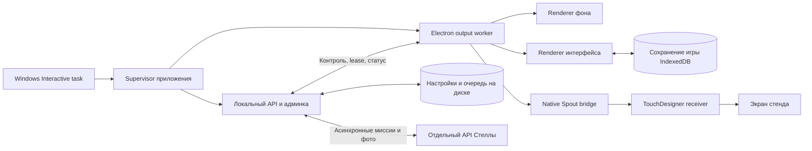

# Устойчивая работа MAX и Стеллы на production стендах

> Уточнение 27.10.2026: пользователь исключил реализацию резерва в TouchDesigner — заставка и контроль приёмника остаются на его стороне. Локальная реализация supervisor/API/output, диагностика и границы выполненной проверки описаны в [отчёте](verification-runtime-resilience-20261027/README.md). Ниже сохранена целевая архитектура; пункты аппаратной приёмки не считаются автоматически выполненными.


Дата: 27.10.2026. **Статус: архитектура для реализации.** Этот документ не меняет запущенные приложения. Основной приоритет — MAX с двумя Spout-потоками; те же правила жизненного цикла применяются к пиксельной Стелле. CHUWI не используется.

## Требуемое поведение

Ошибка одного кадра не закрывает приложение. Потеря графики не закрывает API, админку и очередь передачи. Посетитель не теряет подтверждённые действия; оператор видит причину неисправности и ход восстановления. После исчерпания попыток приложение остаётся доступным для диагностики, вместо бесконечных перезапусков или тихого исчезновения.

Нельзя гарантировать непрерывную картинку при отключении питания, отказе видеокарты или потере физического дисплея. Для программных сбоев вводим проверяемые границы отказа, ограниченное восстановление и резервный экран. «Процесс работает», «кадры передаются» и «изображение видно на стене» — три разных состояния.

## Что привело к текущим остановкам

| Наблюдение в коде | Последствие |
|---|---|
| `stand-output.cjs`: отсутствие texture, неверный размер/handle, ошибка native bridge и потеря renderer вызывают общий `fail()` | Разовый дефект кадра обрабатывается как авария всего приложения |
| `desktop-main.cjs`: `onFatal → app.quit()`; shutdown закрывает `host` | Вместе со Spout исчезают API и админка |
| `window-all-closed → app.quit()` | Плановое пересоздание окон может закрыть оболочку |
| Фон получает tick от content renderer | Зависание контента может остановить и фон |
| `bridge.cpp` загружается в основной Electron-процесс | Нативное падение или зависание нельзя надёжно изолировать через JS try/catch |
| Синхронная запись логов и output-state находится в критическом пути | Ошибка диска может попасть в обработчик отказа графики |
| Готовность выводилась из накопленных frames и флагов | Старые положительные значения не доказывают свежесть картинки |

В журнале зафиксировано `Unexpected shared texture dimensions/handle`, в том числе в 15:32:18 МСК. Лог объединяет разные причины и не содержит фактического размера/типа кадра, поэтому точный первичный триггер пока не установлен. Это основание улучшить диагностику, а не объявлять неисправной видеокарту.

Предыдущий запуск восстановления непосредственно из SSH был отдельной ошибкой процедуры: GPU-приложение нужно запускать в интерактивной Windows-сессии. После запуска через Interactive Scheduled Task оба потока принимались независимым приёмником. Успешный десятисекундный тест не является проверкой длительной устойчивости.

## Границы процессов



**Supervisor** — небольшой процесс без графики и native Spout. Управляет только дочерними процессами своего приложения, проверяет heartbeat, хранит бюджет восстановления и состояние `running / maintenance / stopped`. У MAX и Стеллы отдельные supervisor, данные и панели. Остановка одного не останавливает второй.

**API-процесс** — HTTP, админка, настройки, game-link, дисковая очередь и фото. Существующие порты и URLs сохраняются. Его жизненный цикл не зависит от окон. Используется штатный упакованный runtime; разработческие Node/npm на стенде не нужны. Запуск `ELECTRON_RUN_AS_NODE`, если выбран для API/supervisor, задаётся только дочернему процессу; переменная никогда не наследуется графическим worker.

**Output worker** — отдельный Electron-процесс для окон, WebGL и native Spout. Именно здесь остаётся риск GPU/native crash. Supervisor может завершить зависший worker целиком, не затронув API. Создание окон, bridge и загрузка сцены не входят в startup API.

**Два renderer MAX** остаются отдельными окнами. Они не считаются полностью независимыми: Electron может использовать общий GPU-процесс, а bridge использует один D3D device. При локальной ошибке страницы восстанавливается один renderer; при device loss или нарушении владения текстурами — весь worker. Здоровый фон сохраняется только когда его ресурсы действительно исправны.

**TouchDesigner** отвечает за резервную картинку при отсутствии отправителя. Перезапуск worker временно прерывает Spout; обещать непрерывный sender в этот момент нельзя. Имена `KDW_MAX_BACKGROUND` и `KDW_MAX_CONTENT`, 3072×1536, альфа контента сохраняются. Второй worker не запускается до подтверждённого завершения первого — исключаем дубли sender и суффиксы имён.

На Стелле output worker содержит пиксельный UI. Голосовой backend и аудиопроцессы сохраняют свои существующие границы; ошибка AI, камеры или аудиоустройства не должна завершать API. После потери voice renderer нельзя автоматически возобновлять запись микрофона или повторять последнюю команду посетителя.

## Восстановление по степени отказа

Все значения ниже — начальные параметры реализации, а не уже измеренные гарантии. Бюджеты считаются по монотонным часам и проверяются на целевом железе.

| Ситуация | Реакция | Условие эскалации |
|---|---|---|
| Один неподходящий paint: нет shared texture, неверный размер, другой widget type | Кадр не передавать; учесть отдельный код причины; сохранить последний исправный кадр | Нет исправного кадра слоя более 500 мс → degraded |
| Заполнены 3 native flight-слота | Пропустить новый кадр; не копить очередь и не блокировать поток | Проверять возраст незавершённых GPU-команд; это не успешная передача |
| Нет исправных кадров слоя 500 мс | Снять допуск ввода и прохождения, показать статус оператору | 2 секунды без исправных кадров → один запрос восстановления |
| Renderer завершился / завис | Сначала перезагрузить или пересоздать его окно, восстановить текущую сессию | Не более 3 попыток за 5 минут, интервалы 1/2/4 секунды |
| Device removed, потеря GPU-процесса, неизвестный completion token, просроченные GPU-команды | Остановить допуск, заменить output worker; API жив | Не более 3 перезапусков worker за 5 минут, интервалы 1/3/10 секунд |
| Worker не отвечает на heartbeat | Внешний supervisor обнаруживает зависание независимо от event loop worker | Heartbeat раз в секунду; 5 секунд без ответа → завершение по дедлайну и замена |
| Бюджет восстановления исчерпан | `degraded`, резервный экран, API/админка доступны; кнопка «Восстановить вывод» | Нет бесконечных циклов; ручная попытка журналируется и также ограничена |
| Упал API | Supervisor перезапускает только API; worker блокирует ввод до восстановления связи | 3 попытки за 5 минут, затем операторский статус supervisor |
| Ошибка логирования/метрик | Ограниченный буфер в памяти и сообщение оператору | Не завершать игру из-за диагностической записи |
| Ошибка записи игрового состояния/очереди | Не подтверждать несохранённое действие; сохранить прежнее состояние и показать восстановление | Не продолжать с ложным ACK; диагностику диска отделить от графики |

Окна восстановления не умножают бюджеты: повтор одной ошибки проходит через единый coordinator с `recoveryId`, один inflight restart и номером поколения worker. Запоздалые callback, paint и ACK от старого поколения отбрасываются. Политика не сбрасывает счётчики после каждого успешного кадра; устойчивое восстановление подтверждается минимум 30 секундами нормальной работы.

Известные recoverable-ошибки обрабатываются локально. Неизвестный `uncaughtException` не замалчивается: процесс признаётся неисправным и заменяется извне. Продолжать работу после неизвестного повреждения состояния нельзя.

## Владение текстурами и сохранение изображения

1. Входной paint классифицируется до `bridge.send`: channel, поколение окна, widget type, codedSize, формат, наличие handle. Нельзя закрывать весь MAX из-за несовпадения размера одного кадра.
2. Полученная от Electron texture освобождается ровно один раз. После принятия GPU-команды — только после подтверждения завершения; у пропущенного кадра — сразу, если он не передан GPU. Проверка поколений не отменяет освобождение старого ресурса.
3. Последний пригодный для повторной выдачи кадр должен принадлежать bridge, а не быть заимствованной текстурой Electron. Повтор выдачи реализуется через собственную texture и проверенное fence/query-завершение копии. Нельзя удерживать произвольный paint бесконечно ради freeze.
4. При device loss/неисправном fence не освобождать занятые ресурсы «на удачу» и не создавать новый bridge поверх старого. Предел ожидания drain — 5 секунд; затем уничтожается worker-процесс, который владеет ресурсами. API остаётся отдельно.
5. Начальный пустой кадр контента допустим только во время подготовки. Готовность standby требует реального reveal и подготовленных ресурсов; счетчик frames сам по себе не отличает прозрачный экран от интерфейса.
6. Фон получает собственный ограниченный визуальный tick. Часы фона не двигают игровую сессию; зависание контента не должно лишать фон тиков.

Штатная отправка остаётся GPU→GPU. CPU readback используется только в явной диагностике/приёмке, не на каждом кадре. Изменение native bridge проверяется отдельно; удаление одного `app.quit()` не даёт изоляции от нативного сбоя.

## Что видит посетитель и оператор

TouchDesigner хранит последний успешный composite кратковременно, до 2 секунд. При более долгом отсутствии свежего вывода переключается на локальную брендированную заставку «Сейчас продолжим». Заставка не содержит фото посетителя и не зависит от JavaScript MAX или прихода Spout. При полном отказе GPU самого TouchDesigner эта гарантия не действует.

Возврат к игре выполняется только после совпадения текущего `gameId/runId/screenId`, готовности обоих слоёв и серии исправных кадров. Переход на живой composite — с коротким fade, без показа промежуточных пустых кадров. При истёкшей по действующим правилам сессии показывается её штатный итог, а не чужая или заново созданная игра.

В админке отдельно показываются: API, renderer, фон, контент, Spout sender, доступность receiver, LiDAR, ARM, активное восстановление, последняя ошибка и число попыток. При падении API supervisor предоставляет минимальный локальный status/retry интерфейс на отдельном loopback-порту, выбранном и проверенном при реализации. Операторский браузер не должен исчезать вместе с игровым worker.

Действия: «Перезапустить вывод», «Перезапустить API», «Остановить приложение», «Диагностика». Перезапуск вывода не сбрасывает прогресс. Очистка сессии остаётся отдельным явным действием. Все управляющие endpoints сохраняют Origin/token-проверки; диагностический status не публикуется в LAN без авторизации.

## Состояние игры и допуск

Сохраняем существующий mission-core и IndexedDB как источник подтверждённого игрового прогресса. Дисковый game-link отвечает за назначение/claim и очередь; это не второй независимый игровой движок. Миграция всей игры на серверное состояние не требуется для первого выпуска устойчивости.

У worker постоянный каталог профиля; пересоздание окна/процесса не создаёт новый profile, sessionId или contentRevision. Одновременно допускается только один renderer-владелец сессии. Новый worker получает lease с новым generation; старый не может отправлять ввод или подтверждать готовность.

Критический пользовательский результат подтверждается только после штатного commit. Восстановление читает последнюю подтверждённую ревизию; недоставленные команды имеют idempotency key. Не обещаем сохранение ещё не зафиксированного движения руки или текста, который пользователь не отправил.

При stale output немедленно запрещаются новые команды и визуальные подтверждения. Сбрасывается удержание ладони, чтобы восстановление не засчитало старый контакт. Неизменяемы ранее согласованные правила claim, дедлайнов, retention и коррекции часов: сбой не выдаёт новый полный бюджет. Уже существующие временные правила восстановления сохраняются; новая политика компенсации времени простоя потребует отдельного решения.

ARM не включается автоматически. После пересоздания worker требуется повторный операторский допуск; при восстановлении без смены worker исходный ARM может сохраниться, но фактический ввод блокируется до свежей готовности. Standby виден при ARM=false — это уже реализованная правка прозрачного меню.

Для Стеллы при перезагрузке renderer восстанавливается серверный этап только при действительном токене/ревизии. Неподтверждённый снимок не выдаётся за сохранённый. Фото, принятое локальным outbox, продолжает доставляться независимо от UI. Повторные голосовые действия и озвучка защищены идентификатором запроса; при невозможности безопасного resume показывается явное «Начать сначала», без удаления уже принятой передачи MAX.

## Протокол здоровья

`health` означает доступность API; `ready` — пригодность конкретного пути посетителя. Предлагаемый статус содержит:

```json
{
  "serviceInstanceId": "uuid",
  "workerGeneration": 12,
  "sequence": 245,
  "state": "degraded",
  "api": "ready",
  "renderer": "recovering",
  "background": {"lastGoodFrameAgeMs": 12, "frames": 4001},
  "content": {"lastGoodFrameAgeMs": 2400, "frames": 1990},
  "receiver": "unknown",
  "armed": false,
  "inputAllowed": false,
  "recovery": {"id": "uuid", "attempt": 1, "reason": "CONTENT_FRAME_STALE"}
}
```

Возраст кадра измеряется по монотонным часам отправителя; получатель отдельно измеряет возраст последнего сообщения по своим часам. Не сравниваем monotonic timestamps разных процессов/ПК. Heartbeat просрочен — статус становится `unknown/unavailable`, а не продолжает показывать прежнее ready.

Доставка в Spout не доказывает приём TouchDesigner. Его heartbeat должен сообщать свежесть обоих входов и текущий выбранный вывод. До реализации такого heartbeat поле receiver остаётся `unknown`; операторская проверка изображения на стене сохраняется. Механизм паузы из-за отсутствия receiver вводится только вместе с приёмником, чтобы не заблокировать существующий стенд навсегда.

## Windows и управление запуском

- GPU-worker запускается только в интерактивной сессии назначенного пользователя. SSH лишь поручает это Interactive Scheduled Task. Перед запуском проверяются sessionId, активный пользователь и наличие заданного дисплея.
- По одному supervisor/worker каждого приложения: mutex/lease с process-start identity, проверкой пути release и поколения. Один PID без времени старта недостаточен.
- Supervisor проверяет и сам процесс, и ответ на heartbeat; существование PID не доказывает работоспособность. Зависший worker останавливается по дедлайну; бесконечного ожидания shutdown нет.
- Windows-задача восстанавливает supervisor при неожиданном завершении. Записанное `desiredState=stopped` запрещает перезапуск после намеренной остановки; Stop/обновление сначала меняют desiredState, затем закрывают процессы.
- Обновление переводит только нужное приложение в maintenance. Supervisor не борется с установщиком. После атомарной установки/проверки манифеста восстанавливается прежний разрешённый режим. Ошибка запуска → откат к известной рабочей версии; данные и настройки не откатываются автоматически к чужому снимку.
- Текущие роли ПК сохраняются: MAX — DR7, Стелла — DR2; обе сборки остаются на обоих ПК. Изменение роли или дисплея — отдельная операция.

## Диагностика без постоянного SSH

При ошибке сохраняется структурированный fault bundle: release/patch, процесс и generation, channel, ожидаемый и фактический размер, widget type, pixel format, наличие handle без его значения, adapter LUID, HRESULT/device-removed reason, версии Electron/драйвера, Windows sessionId, дисплеи/DPI, возраст последних исправных кадров и число inflight. Для текстуры без handle и неверного размера используются разные коды.

Повторяющиеся ошибки агрегируются с count/firstSeen/lastSeen. Логи ротируются: начальный бюджет 5×10 МБ на приложение; diagnostic bundles — 10 последних, не более 200 МБ суммарно. Секреты, фото, голос и содержимое пользовательских сообщений в технический bundle не включаются. Запись логов не может аварийно остановить основной цикл.

Приёмка/диагностика запускается готовой локальной командой или из админки и возвращает один отчёт. SSH используется для доставки маленького патча и получения результата, а не для разработки через последовательные опросы стенда.

## Порядок реализации

| Этап | Изменения | Условие завершения |
|---|---|---|
| 1 — локальное восстановление | Классификация paint, расширенный лог, state machine восстановления, убрать закрытие host из известных графических отказов; разорвать tick-зависимость фона | Инъекция плохого кадра и renderer crash не закрывает API. Это промежуточная защита, не изоляция native crash |
| 2 — граница процессов | Общий supervisor, отдельные API/output worker, IPC/lease, интерактивный запуск и managed Stop/maintenance | Kill/hang/native crash worker не закрывает API; нет дублей процессов/sender; после восстановления тот же committed state |
| 3 — резервный показ | Last-good frame, независимая TD-заставка, receiver heartbeat и плавный возврат | На стене не остаётся бесконечно пустой или устаревший пользовательский экран |
| 4 — интерфейс оператора | Статусы свежести, ручное восстановление и единый fault bundle | Оператор понимает неисправность без SSH; ни одна кнопка retry не очищает игру |
| 5 — приёмка и поставка | Fault injection, длительный прогон, малый патч через готовый установщик | Выполнены критерии ниже; отчёт фиксирует реальные пределы |

Код размещается в корневых `apps/STARTUP/tools` и `apps/<app>/launcher`; generated frontend меняется через адаптер. Общие файлы распространяются `npm run build:shared`, source проверяется `npm run check:generated`. Замороженный stand-base не правится. Для нового supervisor/IPC нужны отдельные тесты жизненного цикла; UI и правила миссий не переписываются ради восстановления.

## Приёмка устойчивости

| Испытание | Обязательный результат |
|---|---|
| Одиночный плохой paint; серия плохих кадров; resize/DPI | Отдельный кадр не завершает процесс; серия ведёт к одному ограниченному восстановлению |
| Kill renderer, зависший JS, native worker crash | API/админка доступны; старый owner исключён; сессия восстановлена из commit |
| GPU completion timeout/device loss | Нет преждевременного release; worker заменён; после 3 неудач — degraded, без restart storm |
| Отсоединить/подключить дисплей; сменить DPI; RDP и возврат в console | Нет бесконечной смены размеров/окон; session mismatch диагностируется; восстановление проверяется в console |
| Остановить/запустить TouchDesigner | Сервер и игра не исчезают; нет дублей sender; резервная композиция и возврат подтверждены визуально |
| Ошибка диска, read-only data, переполненный лог | Нет ложных ACK; диагностика не обрушает работающий renderer |
| Потеря LAN, Стелла недоступна, фото приходит поздно | MAX автономен; фото относится только к своему gameId; новой игры из-за повтора нет |
| Сбой во время ладони, ответа, результата, QR | Нельзя повторно засчитать контакт/ответ, сбросить таймер или потерять подтверждённую ревизию |
| Stop оператора, обновление, rollback, перезагрузка Windows | Нет самовольного запуска после Stop; maintenance не воспринимается как авария |

Программный gate: `npm run test:audit:all` и новые fault-injection тесты. Перед первой установкой — 30 минут аппаратного прогона с управляемыми сбоями на production-ПК; перед утверждением окончательного выпуска — 8 часов непрерывной работы с периодическими миссиями и фото. Десять секунд Spout используются только как smoke-test.

Целевые показатели приёмки: ноль непреднамеренных завершений API; ноль потерянных подтверждённых действий и дубликатов сессий; все заданные отказы приводят либо к восстановлению в ограниченный срок, либо к явному degraded. Цель обычного восстановления renderer — до 10 секунд, worker — до 15 секунд при исправном GPU. В штатном режиме приёмник получает в среднем не менее 55 кадров/с каждого потока в 60-секундных окнах; простои восстановления фиксируются отдельно и не скрываются усреднением. После прогрева память не растёт монотонно на серии из 100 восстановлений; GPU inflight и число процессов остаются в установленных пределах.

Все цели подтверждаются измерениями; невыполненный критерий записывается как незавершённый. Установка кода, HTTP 200, растущий счётчик кадров и правильная картинка на экране фиксируются раздельно.

## Связанные документы

- [Независимый обмен Стелла и MAX](STELA_MAX_ASYNC_ARCHITECTURE.md)
- [Фактически реализованный async-link и границы проверки](verification-async-link-20261027/README.md)
- [Исправление прозрачного standby до ARM](verification-spout-idle-20261027/README.md)
- [Правила сохранения, таймеров и восстановления](verification-audit-fixes-20261026/README.md)
- [Быстрые обновления стендов](STAND_FAST_ITERATION.md)
