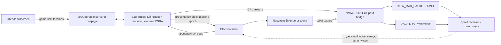

# Экспорт MAX и Стеллы на тестовый стенд PREMIUM-CHUWI

Дата: 27.10.2026. Статус: архитектура полной интеграции. Отдельный GPU-прототип двух Spout-потоков реализован в [apps/max-game/source/spout-prototype](../apps/max-game/source/spout-prototype/README.md). Реальные MAX dual Spout и Stella fullscreen собраны в KDW-Stand-20261027-RC2: [отчёт](verification-stand-release-20261027/README.md), [запуск](STAND_RELEASE.md). Аппаратная приёмка реальных приложений на CHUWI, автоматическое совместное обновление и откат рабочего стенда остаются следующими этапами.

Уточнение поставки: по согласованию с пользователем готовые сборки доставляются через GitHub Releases. Runtime скачивается отдельно из официального релиза, сохраняется на стенде и проверяется по SHA256. SSH остаётся для коротких управляющих команд, статуса и логов. Публичная публикация исходников и пакета прототипа в `premium-producer/MAX-Game` отдельно разрешена пользователем.

## Назначение

PREMIUM-CHUWI становится тестовым стендом проекта. MAX работает в Electron и отдаёт **два самостоятельных Spout sender: фон и контент**. Стелла работает в обычном полноэкранном окне Electron, без Spout. Исходники остаются в канонических `apps/UI/docs/ops`; на стенд отправляется проверенный runtime-пакет без дерева разработки.

Для первого стенда предлагается профиль `one-pc`: MAX, Стелла и приёмник Spout находятся на CHUWI. Предусмотреть также отдельные `max-only` и `stela-only`, используя существующую HTTPS-связь приложений. Spout передаёт изображение между процессами одного Windows-ПК; перенос игры на второй ПК означает перенос приёмника Spout вместе с ней, а не отправку Spout через SSH.

## Подтверждённое исходное состояние

| Компонент | Сейчас | Требуется |
|---|---|---|
| MAX | `apps/max-game/launcher/desktop-main.cjs`, обычный BrowserWindow; runtime Electron 44.4.5 | Отдельный профиль вывода `spout-dual`, GPU bridge и два слоя |
| Фон MAX | `journey-lumi-reference-background.mjs`, отдельный `#ambient`, его tick вызывается игровым циклом | Пассивное отображение фона с управляемыми временем и готовностью |
| Контент MAX | `webgl-field.js` + `journey-webgl-ui.mjs`, прозрачный WebGL, поверх есть интерактивные DOM-слои | Финальная композиция WebGL и DOM с прозрачностью без фонового CSS |
| Стелла | Electron, production fullscreen; автоматический поиск портретного монитора | Явный выбор дисплея для стенда, прежние голос/камера/VST |
| Связь | Общий `apps/STARTUP/tools/game-link.cjs`, очередь, claim, замещение до ладони, восстановление | Сохранить один экземпляр игрового владельца и прежний протокол |
| Поставка | `ops/production-build/build.py`, `update.cjs`, SHA-манифесты | Отдельный явный профиль стенда, предварительная загрузка и откат целого выпуска |

Обычная сборка сохраняет `app.json`. Старый упаковщик создаёт несколько комплектов и переносит часть приватных настроек автоматически; его нельзя применять к стенду вслепую. Новый экспорт должен формировать только выбранный профиль и отделять код от локальных настроек.

## Тестовая машина

Идентификатор Kit: `2b9d1f12-e138-4e4f-989a-e982ce214125`; карточка `PREMIUM / PREMIUM-CHUWI`, **staging**. Windows hostname `DESKTOP-MR4IT1A`. SSH через существующий helper `PRODUCER-KIT/workspace/connection-check/premium-chuwi-2026-10-27/ssh.py`, с проверкой UUID и закреплённого host key. Desk ID: Selectel `907999865`, CloudCore `147146019`.

Чтение оборудования по SSH 27.10 подтвердило Windows 10 Pro 10.0.19045 x64, Ryzen 7 5800H (8/16), около 16 ГБ RAM, AMD Radeon Graphics, драйвер 31.0.12027.9001. WMI сообщает 1920×1080, 59 Гц; также установлен USB Mobile Monitor Virtual Display. Это не полная инвентаризация мониторов и не проверка Spout. На C: свободно около 146 ГБ. Есть активная console-сессия. Перед включением вывода нужен probe Electron display/GPU в этой сессии.

## Процессы и владение состоянием



1. Один main process MAX управляет сервером, окнами, транспортом текстур и восстановлением. Он не создаёт вторую игровую сессию.
2. **Content renderer** — единственный владелец текущего application/session, persistence, production ticker, game-link claim и игрового звука. Он рисует всё, кроме ambient-фона. HTML/DOM-посты, товары, клавиатура и уведомления входят в экспорт вместе с WebGL; захват только canvas недостаточен.
3. **Background renderer** загружает отдельный минимальный entry, а не второй `client.html`. Он получает только визуальные параметры, clock, pause/reduced-motion и scene epoch; не читает очередь/IndexedDB, не отправляет ready/claim и не играет звук. Используется тот же LumiCells-модуль с адаптером viewport/clock. Самостоятельный игровой RAF в нём запрещён.
4. По умолчанию у MAX нет второго полноэкранного окна поверх Стеллы. Необязательный операторский preview — пассивная композиция выходных текстур, без второго application bootstrap. Обычный desktop-профиль сохраняется для разработки.
5. Таймеры игры и визуальные часы разделены. Публикация Spout не должна порождать повторные команды, reset и новую полную длительность задания.

## Контракт двух слоёв

| Свойство | Фон | Контент |
|---|---|---|
| Имя sender | `KDW_MAX_BACKGROUND` | `KDW_MAX_CONTENT` |
| Размер по умолчанию | 3072×1536 | 3072×1536 |
| Координаты | Полное поле, начало сверху слева | То же поле, без обрезки до safe/touch |
| Альфа | 1 во всех пикселях | 0 вне контента; мягкая альфа на краях |
| Состав | Ambient, градиенты и пиксельное поле LumiCells | Логотип, видео, устройства, линки, частицы/флюиды взаимодействия, ладонь, текст, таймеры, кнопки, посты/товары, клавиатура, QR |
| Цель частоты | 60 FPS, проверяется на CHUWI | 60 FPS, проверяется на CHUWI |

Предложенный выходной формат: BGRA8 UNORM, SDR, premultiplied alpha у контента. Native bridge обязан проверить реальный формат Electron и при необходимости преобразовать его; нельзя предполагать порядок каналов и alpha mode. Receiver композитит контент поверх фона с тем же соглашением alpha и согласованным цветовым пространством. Проверочные паттерны: полупрозрачные белые/цветные края на чёрном и белом, градиенты, QR, фото и glow. Если конкретный receiver требует straight alpha, конверсия делается явно в одном месте с отдельным профилем, а не повторным умножением RGB.

Разделение не сводится к скрытию `#ambient`: проверить `html/body/#arena`, чёрные backing surfaces, CSS-псевдоэлементы, loading/error overlays и постобработку. Флюиды ладони и связи остаются в контенте, чтобы их можно было наложить на фон. Художественные материалы внутри самих устройств/плашек не становятся прозрачными.

Оба слоя используют одинаковый логический viewport, DPR=1 и масштаб игры. Pixel-map сохраняет x=560…2320 для touch-зоны и прежний safe 7%; размер физического монитора CHUWI не уменьшает автоматически Spout-текстуры. Профиль 1920×960 допускается только явно для диагностики производительности, с тем же соотношением сторон, без изменения игрового каталога и таймингов.

## GPU транспорт

Использовать Electron offscreen shared textures и нативный Windows x64 модуль на Node-API/D3D11 + Spout2 SDK. Electron описывает этот путь как вывод GPU-текстуры с native module; bitmap-путь требует копирования GPU→CPU. Он не является основным транспортом стенда. [Electron offscreen rendering](https://www.electronjs.org/docs/latest/tutorial/offscreen-rendering/).

Предлагаемый pipeline: `BrowserWindow offscreen/useSharedTexture → paint texture → D3D11 import → собственная текстура sender → Spout SendTexture`. Spout2 имеет DirectX 11 sender API; итоговую совместимость проверить на закреплённых версиях Electron/SDK и реальном GPU. [Spout DirectX SDK](https://github.com/leadedge/Spout2/blob/master/SPOUTSDK/SpoutDirectX/readme.md), [SpoutDX API](https://github.com/leadedge/Spout2/blob/master/SPOUTSDK/SpoutDirectX/SpoutDX/SpoutDX.h).

Требования к bridge:

- GPU, используемый Chromium, мостом и receiver, должен быть совместимым; записывать adapter LUID. USB virtual display не выбирать как GPU по умолчанию.
- Windows `ntHandle` относится к текущему процессу. Для первой версии импортировать его внутри main process через native addon. При последующем выносе в отдельный broker понадобится корректное дублирование handle и IPC ownership; передавать числовой handle как глобальный нельзя. [Electron SharedTextureHandle](https://www.electronjs.org/docs/latest/api/structures/shared-texture-handle).
- В main сохраняется объект texture до завершения использования bridge. `release()` вызывается ровно один раз после безопасного окончания GPU-copy/синхронизации, включая ошибочные пути. Нельзя освобождать текстуру сразу после постановки асинхронной копии в очередь. Число кадров в работе ограничено; переполнение отбрасывает устаревший кадр, а не наращивает очередь. [Electron OffscreenSharedTexture](https://www.electronjs.org/docs/latest/api/structures/offscreen-shared-texture).
- У Electron и Spout различаются механизмы sharing/synchronization; native bridge владеет отдельной выходной текстурой, соблюдая SDK-синхронизацию. Нулевая CPU-копия — цель; абсолютный zero-copy не обещается.
- `widgetType=popup` не принимать за основной полный кадр. Нативные popup-контролы заменить inline UI либо явно скомпозитить до sender. При частичной перерисовке сохранять остальные пиксели собственного полного кадра.
- Уничтожать sender, callbacks, handles и D3D resources при закрытии/смене renderer generation. Сохранять имена sender при восстановлении, не создавать суффиксы (2)/(3).

Первый этап — технический прототип двух прозрачных/непрозрачных тестовых поверхностей на CHUWI. Он проверяет D3D import, alpha и реальный receiver **до** подключения игровых маршрутов. Native модуль поставляется готовым, вместе с нужными DLL/лицензиями. Node, CMake, Visual Studio и Spout SDK на стенде не устанавливаются как средства разработки.

## Синхронизация показа и ввод

Content renderer отправляет ограниченный presentation packet: `schemaVersion`, `generation`, `sceneEpoch`, `presentationTime`, `active`, `reducedMotion`, визуальные параметры фона. Во время перезагрузки принимаются только сообщения актуальной generation. Два BrowserWindow не гарантируют аппаратно одновременный кадр: нужна измеренная задержка, а не обещание frame-lock. На смене scene epoch публикация новых слоёв проходит через барьер готовности; если необходима строгая синхронизация receiver, потребуется дополнительный локальный metadata/ack канал. Независимые Spout-потоки сами по себе не являются атомарной парой.

Текущий код использует `document.hidden`, `document.hasFocus()` и `presentationActive()`. В `spout-dual` заменить зависимость от видимости offscreen-окна отдельным сигналом готовности вывода, сохранив обычное поведение desktop. Одного `backgroundThrottling:false` недостаточно, если код сам ставит анимацию на паузу. Визуальный таймер результата запускается после готовности слоя; пользовательское приглашение — после готовности конечного вывода. Сигнал «sender создан» не доказывает, что посетитель видит экран. Предусмотреть ACK receiver либо явный операторский ARM для receiver без такого API.

**Открытое уточнение:** какой receiver будет использоваться и кто получает тач. До уточнения реализовать раздельный input port, без жёсткой зависимости от TouchDesigner.

- Если ввод приходит от receiver: локальный аутентифицированный канал, нормализованные координаты → единый viewport 3072×1536 → штатный input adapter игры. Передавать pointer id/down/move/up/cancel; отклонять старую generation, неверную последовательность и координаты вне touch-зоны. Не обходить удержание ладони и claim.
- Если используется Electron preview: preview лишь передаёт ввод в единственный content renderer после обратного преобразования масштаба/letterbox. Один выбранный input source исключает двойные события.
- Требуется проверить trusted/native input и фокус текстовых полей: произвольный DOM `dispatchEvent` не считать полноценной заменой мыши/тача. Путь для pointer/multi-touch закрепить прототипом с настоящей клавиатурой игры.
- Spout не передаёт ввод или звук. Аудио MAX идёт через выбранное Windows audio device; аудио/камера/VST Стеллы сохраняют отдельные настройки.

## Полноэкранная Стелла

Стелла использует свой BrowserWindow, обычный local origin и прежние permissions. В профиль стенда добавить выбор дисплея: сохранённый идентификатор плюс проверяемые характеристики/геометрия, поскольку идентификатор может измениться после переподключения. Если целевой дисплей отсутствует — понятное состояние оператора, без скрытого перекрытия чужого экрана.

При одном физическом мониторе Стелла может быть fullscreen, а MAX отдаёт offscreen-потоки. Одновременная полноэкранная композиция MAX на том же мониторе невозможна без явного переключения владельца экрана. Для совместной посетительской проверки нужны два выхода либо согласованный режим переключения. WMI 1920×1080 не подтверждает наличие портретного экрана — разрешение Стеллы пока не фиксируется.

## Структура стендовой поставки

Предлагаемая установка `C:/KDW-Stand/` (путь задаётся при первом развёртывании):

```text
C:/KDW-Stand/
  control/                  # Start, Stop, Status, Activate, Rollback
  current.json              # releaseId активного согласованного набора
  releases/<releaseId>/
    apps/max-game/          # launcher, www, native bridge
    apps/stela/             # launcher, www, native audio host и VST
    apps/STARTUP/           # общие модули этого выпуска
    runtime/electron/       # один закреплённый runtime
    release-manifest.json  # SHA, размеры, buildId, версии протоколов/ABI
    licenses/
  incoming/<releaseId>/    # недокачанный/непроверенный выпуск
  shared/
    stand.local.json       # дисплеи, Spout, topology, пути, audio/input
    max-game/              # settings, очередь, persistence, profile, логи
    stela/                 # Qwen, voice/VST presets, profile, outbox, логи
    pairing/               # только если нужен two-pc
  rollback/                # указатели и контрольные квитанции
```

Это новый контракт, не описание уже работающих путей launcher. Сейчас `data` и `settings` вычисляются относительно app root. Для установки с версиями требуется **общий resolver путей** и миграция всех владельцев записи: серверы, launcher, journals, profiles, outbox, очередь, settings, token/runtime.json, сертификаты и native audio host. До полного аудита записи нельзя объявлять releases неизменяемыми. Не подменять это копированием живой БД между версиями.

В манифест выпуска включить версии Electron, native bridge/ABI, Spout SDK, MAX/Стеллы, общий protocol/sharedRevision, supported state schema и карту файлов. Код выпуска не содержит SSH-ключей оператора, Qwen-секретов, фото/истории посетителей и браузерных кэшей. Приватный bootstrap переносится отдельно по защищённому каналу один раз; последующие обновления его не заменяют. На стенд не отправляются Git, node_modules, source, старые экспорты, Figma-пакеты и проверочные медиа, не нужные приложению.

Профиль `stand.local.json` должен явно задавать: `targetId`, `topology`, `releaseId`, `max.output=spout-dual`, два sender name, width/height/FPS/alpha, input source, receiver readiness policy, display Стеллы, общие data/settings paths. Секреты — ссылки на закрытые локальные файлы. Не менять `app.json` рабочего корня при выборе профиля экспорта.

## Сборка, доставка и откат

1. **Build:** `build:shared`, `check:generated`, обе штатные сборки и аудит-тесты. Native bridge собран и проверен на закреплённом Windows x64 toolchain. Входные SHA снять до/после, чтобы параллельная правка не дала смешанный пакет.
2. **Export:** будущая отдельная команда `export:stand --profile premium-chuwi`. Она пока не существует; не подменять её обычным `build`. Выдаёт один runtime-пакет, манифест и отчёт, без перезаписи существующих production-профилей.
3. **Upload:** публикация проверенного пакета в GitHub Releases, затем скачивание стендом по HTTPS в `incoming/<releaseId>` с повторяемой докачкой. Проверить UUID/hostname перед управляющими командами; путь ограничить корнем стенда. SHA — целостность, доверие источнику обеспечивают проверенный GitHub-репозиторий, HTTPS и SHA, полученный через закреплённый SSH. Секреты не публикуются.
4. **Preflight:** сравнить SHA, свободное место для нового и предыдущего выпусков, Electron/native ABI, GPU/receiver, display mapping и state schema. Не проверять занятость портов запуском второго экземпляра поверх работающей игры.
5. **Activate:** запретить новые назначения в окно обслуживания, дождаться окончания активной игры либо явной команды оператора; остановить только процессы этого стенда. Закрыть ресурсы, сохранить consistent checkpoint. Атомарно заменить `current.json` и запустить оба приложения из одного выпуска. Новая схема не должна отменять старый gameId или выдавать новый бюджет.
6. **Health:** проверить серверы, очередь, готовность renderer/Стеллы, оба sender/формат/размер/кадры, вход receiver или операторский ARM. Проверять возраст последнего кадра с учётом paused/static режима: Electron может не присылать `paint`, когда изображение не меняется.
7. **Rollback:** при неуспешной активации остановить новый выпуск и вернуть предыдущий указатель. Общие данные сохраняются. Автооткат разрешён только при совместимой schema; миграции должны иметь отдельный план snapshot/restore без потери посетителей. Не удалять последний исправный выпуск и данные, появившиеся после активации.

SSH используется для передачи, управления и статуса. GUI запускается зарегистрированным launcher в **интерактивной console-сессии** пользователя стенда (например, Scheduled Task с InteractiveToken, только при входе пользователя). Отсутствие сессии — `waiting-for-login`, а не ложный PASS. Не хранить пароль Windows в скриптах. Producer Desk нужен для визуальной проверки и обслуживания; процессы игры не зависят от открытого сеанса Desk. Автологин, изменение служб, firewall и установка задач пока не выполняются.

## Отказы и наблюдаемость

Сохранить принятые AUDIT-FIXES: до ладони замещение выбора, после claim активную игру не отменять; bounded renderer recovery; пользовательские deadlines не перезапускаются. Ошибка bridge/GPU добавляет отдельное состояние вывода, не маскируется под неявку посетителя. Пересоздание sender не запускает новую миссию. Не оставлять зависший кадр с фотографией посетителя как постоянный output: supervisor снимает готовность, receiver показывает нейтральную локальную ошибку/фон. Последний валидный background допустим на короткое восстановление; content с прежним посетителем очищается по контракту.

Status должен показывать `releaseId`, PID/session, GPU LUID, размер/формат/alpha/FPS обоих sender, dropped/inflight frames, generation, возраст кадра, renderer state, input connection, receiver armed, queue/claim health. Секреты, содержимое фото и текст личных сообщений в диагностику не включать. Логи ротируются.

## Этапы реализации и приёмка

| Этап | Результат | Критерий перехода |
|---|---|---|
| 1. GPU прототип | Две тестовые поверхности Electron → Spout на CHUWI | Receiver видит оба sender; alpha/каналы/ориентация верны; нет накопления handles; проверены 3072×1536 и явный diagnostic profile |
| 2. Слои MAX | Один игровой owner, отдельный ambient, DOM входит в content | Сложение двух слоёв визуально совпадает с desktop; ладонь/флюиды/линки/QR/клавиатура сохранены |
| 3. Ввод и показ | Receiver/preview input, ready/ARM, presentation clock | Удержание ладони и переход результата корректны; нет двойных команд, таймер не стартует до видимого вывода |
| 4. Поставка | Resolver данных, export, upload, activate, rollback | Проверка SHA и восстановления; повторная доставка безопасна; настройки и активная сессия сохранены |
| 5. Совместный стенд | MAX Spout + Стелла fullscreen | Все 4 миссии/3 бизнеса, очередь из 3 посетителей, фото/без фото, голос, повторный выбор и перезапуск |
| 6. Длительный прогон | Измерения на физическом CHUWI | Не менее 2 часов с GPU/VST/камерой; нет роста handles/памяти; записаны FPS p50/p95, задержки ввода, пропуски кадров и восстановление |

Цель 60 FPS не считается выполненной по unit-тестам. На встроенной Radeon нужно измерить игру, два GPU-вывода, receiver и Стеллу одновременно. При нехватке ресурсов сперва измерить узкое место и выбрать явный профиль (например, 30 FPS), не менять игровые 30/60/120/15 секунд и не снижать разрешение скрыто.

Работы вести в `apps/max-game/source` и адаптере `adapt-stand-main.mjs`, native transport — отдельный модуль под source, launcher — в `apps/max-game/launcher`; общие paths/startup/recovery helpers — в `apps/STARTUP/tools` с `build:shared`; exporter — в `ops`. Frozen stand-base и старый desktop-профиль сохраняются. Этот документ включён в явный sync-список; публикация, установка на CHUWI и смена рабочего профиля этим этапом не выполнялись.
