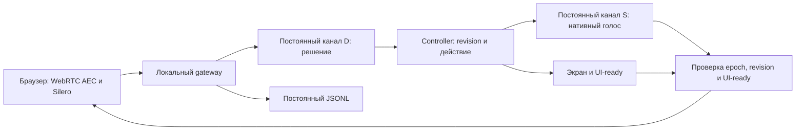

# Архитектура ускорения реакций стелы MAX

**FULL,19.10.2026: четыре миссии на основном /stella/, единый Controller для голоса и касаний, contract v2 с тремя направлениями/двумя личными целями. D Omni + S TTS Katerina,512мс/память/защита/журнал сохранены. «Да» не выбирает из нескольких вариантов. cancelled/incomplete tool не получает function_call_output; отправка/пропуск отражены trace-событиями. Только выдача миссии, без игры. Ниже история архитектуры; актуальное поведение и синтетические проверки — в отчёте FULL.** [Отчёт](verification-20261019/stela-full/README.md).

**KATERINA, 19.10.2026 — установлено:** по выбору пользователя штатный голос Katerina заменяет default Serena в том же qwen3-tts-flash-realtime. Russian/PCM24k/commit, тёплый канал и защита сохранены. Пять реальных синтетических заказов/два ACK на тёплом и новом канале PASS; это не независимая русская/акустическая приёмка. [Проверки и откат](verification-20261019/stela-katerina/README.md). SCOPE-архив сохранён, клонирование/нормализатор/PCM-кэш не подключены. Исторические разделы с Serena ниже описывают прежние версии.

**Контрольная точка и голос, 19.10.2026 — исследовано, runtime сохранён:** SCOPE зафиксирована чистым проверенным ZIP. [Исследование постоянного русского голоса](STELA_VOICE_CONSISTENCY_RESEARCH_20261019.md) рекомендует сравнить штатный голос и один русский эталон с неизменным профилем; канонические вопросы — возможный PCM-кэш того же диктора через прежний тракт. Одинаковый voice ID/seed/тёплый сокет не являются гарантией акустической идентичности. Не переносить seed/instructions локальной модели в обычный Qwen3 realtime без capability-проверки. Новые Qwen-Audio-TTS3.x используют отдельный task-протокол; будущий адаптер должен сохранить epoch/cancel/AEC-reference/фейды/usage и пройти задержки/русскую приёмку. Новый голос и кэш этим исследованием не подключены.

**SCOPE, 19.10.2026 — установлено:** роль ограничена MAX, назначением стелы, текущим выбором, замечаниями и коротким приветствием. D в том же resolve_turn классифицирует topic; off_topic блокирует навигацию/keyword fallback, сервер заменяет его содержание коротким возвратом и вопросом экрана. Неклассифицированный свободный reply не озвучивается. stand/feedback сохраняют ответ и возвращают вопрос; прерванный вопрос восстанавливается после ответа. Обычный max-reply остаётся контекстным. Controller получает только action. Темы определяет Qwen, не regex входных слов; ошибка классификации остаётся риском. Третий inference не добавлен; длинный промпт добавляет input tokens. Тракт/512/UI-ready/каналы сохранены. [Реализация и проверки](verification-20261019/stela-scope/README.md), [живой диалог и отдельная ошибка cancelled tool](STELA_SESSION_REVIEW_20261019_0946.md). Далее — история предыдущих итераций.

**SCREEN-TTS, 18.10.2026 — реализовано и проверено:** D Omni + серверный план вопроса по фактическому экрану + потоковый Qwen TTS Serena. Общий UI/backend контракт, META_FEEDBACK и доставка questionId/revision, bounded cancel-drain750 мс/epoch, отдельный TTS usageDelta и submittedText. Прежние AEC/Silero/512/фейды/VST/журнал сохранены. На 70 синтезах p50 TTS527 против Omni1153 мс (только S); в Firefox 18 PASS, два перебивания256/256, полная миссия/finish, p50 с endpoint≈2,277 с. Разночтения ASR/дикция не дают обещания идеальной дословности; тихое hello в отрицательном тесте отклонено как эхо, финал с усиленной тестовой речью. [Результаты, границы, установка](verification-20261018/stela-screen-tts/README.md). Установка подтверждается deployment.json. Ниже — история исследования и предыдущей CONTEXTUAL, в которой S был Omni.

**Проверка подхода по документации и опыту разработчиков, 18.10.2026:** [исследование, ограничения API и план приёмки](STELA_APPROACH_REVIEW_20261018.md). Установленная версия не менялась. Живой диалог выявил три расхождения D/S из семи: дословное чтение ниже — назначение S, а не гарантия универсальной Omni-модели. Рекомендуемая следующая итерация: общий контракт UI/Controller/D, серверный выбор сценарного вопроса после фактического перехода, привязка подтверждения к доставленному вопросу и проверка отдельного Qwen TTS вместо генеративного S. Смена S пока не принята/не реализована; это уже не полностью Omni. Постоянное TTS-соединение, отмена, русский голос и задержка должны пройти отдельный протокольный gate. Два Omni-канала/512/защита/журнал остаются действующим runtime; включение semantic_vad и ранняя генерация отдельно исследуются, не включены.

Дата: 18.10.2026. Текущая итерация `KDW-MAX-STELA-OMNI-P1-CONTEXTUAL-20261018`: постоянные D/S, пауза 512 мс, контекстные ответы Qwen и совместимое с Firefox приглушение. R3 (генерация параллельно экрану) остаётся предложением. [Проверки, измерения и статус установки](verification-20261018/stela-contextual/README.md). Исходные измерения R1/R2 ниже исторические.

Цель первоначального R1/R2: убрать лишние подключения Qwen, сократить паузу после речи, сохранить защиту от самоперебивания и постоянное логирование. Новое поручение CONTEXTUAL добавляет содержательный разговор на существующей ветке P1. Другие миссии и запуск игры остаются бэклогом.

## CONTEXTUAL: понимание, ответ и состояние

| Компонент | Ответственность |
|---|---|
| D, Qwen text-only с аудиовходом | В одном inference понять реплику, предложить action и самостоятельно сформулировать короткий reply |
| decision.cjs + Controller | Разобрать completed single tool/целый JSON; отделить reply от action; проверить этап, revision, idempotency, UI-ready |
| S, Qwen text+audio | Озвучить допущенный reply дословно, без повторного ответа на вопрос и без новых действий |
| conversation.cjs | Ограниченная память посетителя, общая для поколений D/S, с отметками воспроизведения |

Основной путь: аудио → D `{action, reply}` → проверка действия → UI-ready →
S `{serverReplyText}` → эффекты/фейды → локальный RTC. reply ≤300 символов,
обычно 1–2 предложения, свободно формулируется Qwen по смыслу вопроса.
Он не подставляется из regex-тем. Новый инструмент по-прежнему один,
resolve_turn, его required-поля — action/reply. Завершённый action-only
остаётся совместимым; лишние/повторные ключи, проза, mixed/multiple output
и reasoning не превращаются в команды. Controller принимает только action.

**Допуск речи:** reply используется при принятой неизменённой команде из
tool/text-json, корректной длине и отсутствии технических подтверждений.
Если резервный словарь заменил действие или контроллер его отклонил,
исходный reply отбрасывается. Резервный S получает актуальный ASR,
короткую историю, serverTask/facts/проверенное состояние и отвечает сам.
Данные посетителя остаются данными JSON, не системными инструкциями.
Если нет также ASR, просит повторить. Дополнительного repair/inference нет.
В основном пути готовый reply не ждёт ASR; исключительное ожидание
ASR для резервного ответа ограничено прежними 350 мс.

**Причина двух ролей:** простой перенос ASR/истории в S сделал ответы
контекстными, но реальная проверка выявила споры о приветствии и повтор
призыва начать. Содержательный ответ теперь формулирует D вместе с выбором,
а S читает готовый текст. Старый copy экрана исключён не только из S,
но и из системного snapshot D и function_call_output. Он использовался
как повторная инструкция приветствовать/запрашивать «поехали» при каждом
clarify. Результат инструмента теперь содержит только допуск, action,
причину и stage/revision/missionId.

**Память:** ≤6 локальных ходов/6000 символов текста; в снимке ≤4 предыдущих
ходов и ≤4000 символов сериализованной истории, текущий ASR ≤1200,
выход ≤1000. generated/playing/ended/interrupted/cancelled различаются:
генерация и даже начало playback не доказывают прослушивание всей фразы.
После ротации D восстанавливает ограниченный снимок; на том же соединении
передаётся последний ход, а не вся история повторно. Основной S получает
только готовый reply; резервный S — восстановленный снимок либо два последних
хода. При release память очищается, ссылки на задания/каналы снимаются.

**Скорость и расходы:** два тёплых канала, два inference на обычную реплику,
без третьего запроса. Инструкции сокращены, из D snapshot убраны prompt,
ready и sessionId: проверка готовности остаётся на сервере, её переключение
не вызывает лишний config ACK. S в основном пути получает один текст,
без повторения состояния и всей истории. Endpoint512, idle96, duck-probe,
echo-hint, epoch/cancel/terminal barriers, VST3 и фейды сохранены.
Готовность экрана по-прежнему предшествует генерации S.

voice.reply/context и provider context.attached различают основной/резервный
ответ, размеры/режимы контекста и ожидание; playback.duck mode/duck_error
показывают работу gain. Usage считается один раз по response ID,
подготовительный синтез и неудачные тесты не смешиваются с замером прохода.
Программная проверка Firefox не заменяет акустическую приёмку.

Далее сохранено исходное исследование R1/R2; описания action-only и S без
контекста относятся к прежним версиям.

## Реализованная итерация R1/R2

**Дополнение BARGE-DIALOGUE:** idle 96 мс, конец речи 512 мс, два фиксированных D/S и UI-ready сохраняются. Перебивание использует ограниченный duck-probe с признаком эха, без дополнительного облачного решения; accepted не озвучивается, explain содержит факты MAX. Подробности в [STELA_AEC.md](STELA_AEC.md) и [проверках](verification-20261018/stela-barge-dialogue/README.md).

**Дополнение COMMANDS:** completed native resolve_turn и целый строгий JSON с одним action проходят общий parser и прежний контроллер. Текст вне JSON, дополнительные/повторные ключи, смешанные/множественные команды и reasoning не выполняются. Список tools/manual-mode повторяется при обновлениях instructions; ACK логируется с hash/revision/names и not-reported для отсутствующих полей. Форматная ошибка явно отличается от clarify и не создаёт повторной генерации. Диагностика ordinary D text и типов output подчиняется text-off/redaction. Отмена активного ответа один раз направляется собственному каналу. Периодическая отправка телеметрии без keepalive и с чтением HTTP body сохраняет доставку в длинном проходе. Полный реальный голосовой браузерный путь подтверждён синтетическими репликами: [результат, скорость, расход и границы](verification-20261018/stela-command-fix/README.md).

`launcher/voice/persistent.cjs`: DialogueSession на локальную аренду посетителя, два Channel с фиксированными модальностями, задания PersistentTurn с прежним интерфейсом gateway. Каналы прогреваются параллельно при attach. Изменения инструкций D сериализуются и подтверждаются session.updated, по возможности пока звучит S/идёт захват следующей фразы. S получает только серверный snapshot и инструкцию, его инструменты выключены. Окончание UI по-прежнему предшествует запросу озвучки.

Один активный response на канал. Отмена до response.created запоминается заданием и отправляется после создания; следующий запрос ждёт response.done, максимум 8 с до сброса зависшего канала. Ответы привязаны к responseId, connectionId/generation и исходному заданию; закрытое задание не отправляет звук/текст клиенту. Ошибка канала не повторяет платный запрос; следующее новое задание может открыть замену. 55 с ограничивают задание, аренда — 5 минут; idle не ограничивается прежним таймером 55 с. WS control ping 25 с / pong timeout 10 с, без аудио и inference при простое.

**История:** отдельная ротация D/S после 4 terminal responses (включая cancelled), 1 920 000 входных PCM-байт (60 с) либо latest response usage.input_tokens ≥8192. Проверяется на безопасной границе задания, старый канал закрывается перед открытием замены; окно одного выполняющегося запроса может пересечь порог. Это границы ротации, не неподтверждённое удаление conversation items. Локальное состояние сохраняется. Необработанный input buffer после отмены очищается с ACK; это не удаление истории. Не больше двух живых сокетов, без фоновой генерации при прогреве/ротации. При уходе посетителя оба закрываются.

**Пауза:** сервер сообщает endpointPauseMs; браузер по умолчанию завершает реплику после 16 отрицательных рамок по 32 мс. AEC, Silero, подтверждение 96/384 мс, pre-roll, начало/хвост защиты и эпохи сохранены. vad.ended содержит фактический tailMs. Откат независимыми переменными перед перезапуском: `KDW_OMNI_CONNECTION_MODE=per-turn`, `KDW_OMNI_ENDPOINT_MS=800`. Текущая политика видна в `/__kdw/voice/status` и журнале session.created.

**Ограничение реального idle-теста:** Qwen вернул `response_idle_timeout` после примерно 300,9 с без response, несмотря на control ping. Ожидание сохранения сокета все 5 минут не прошло; следующий speech job восстановил канал и получил звук. Дополнительные платные генерации ради keepalive не выполняются. Штатная локальная аренда также 5 минут. Длительное удержание без модельного закрытия не обещается; [сырые события](verification-20261018/stela-persistent/lifecycle.json).

**Измерено:** одинаковые три синтетические русские реплики с передачей PCM в темпе реального времени, одинаковые UI-задержки, реальные Qwen-сервисы. До первого аудиочанка от конца PCM с паузой: median 4722 → 2955 мс, −37,4%; WSS opens 6 → 2. Полученный total usage 5880 → 6146 (+4,5%). Это N=3 на режим, не оценка полевого p95 или процента стоимости. Пауза детектора смоделирована явным ожиданием; браузер отдельно подтвердил 512 мс и AEC. [Сравнение и проверки](verification-20261018/stela-persistent/README.md), [полные usage](verification-20261018/stela-persistent/comparison.json).

Разделы 1–12 ниже сохраняют исходное исследование и план приёмки. Полная матрица полевых/30 реальных реплик ещё не выполнена; фактический объём этой итерации и ограничение idle указаны выше и в отчёте.

## 1. Рекомендация

Создавать **два постоянных Qwen WebSocket-соединения на одного посетителя**, с неизменными ролями:

| Канал | Ввод | Вывод | Ответственность |
|---|---|---|---|
| D — решение | Очищенное аудио посетителя, текущий snapshot | Text-only, ограниченный resolve_turn | Предложить действие; не озвучивать его |
| S — речь | Серверное задание на текущую озвучку | Нативные text+audio Omni | Произнести подтверждённый сервером вопрос/результат |

Оба открывать параллельно при присоединении голосового клиента после нажатия логотипа и запроса микрофона. Завершать при уходе посетителя. Между репликами закрывать **задание**, а не транспорт. Модальности не переключать. Аудиосхему local WebRTC AEC → Silero → WS сохранить.

Внедрение разделить: сначала постоянные каналы при прежней паузе/готовности UI; затем 512 мс вместо 800; отдельно — параллельную подготовку озвучки и экрана с обязательным запретом воспроизведения до UI-ready.

## 2. Что установлено исследованием

### Исходный код и измерения

- В `launcher/voice/provider.cjs` конструктор ProviderTurn открывает WSS; speak создаёт второй ProviderTurn; done/close завершают соединения. `gateway.cjs` создаёт новый Turn на speech.start, а cancel уничтожает его. Это жизненный цикл хода, ошибочно совмещённый с жизненным циклом соединения для задачи низкой задержки.
- Таймер 55 с сейчас относится к объекту, владеющему WSS. Его нельзя просто оставить при переходе на постоянный канал: он станет разрывать разговор. Тайм-аут ответа и срок сессии нужно разделить.
- При прежнем исследовании session.update подтвердил смену text → text+audio, но последующий Response остался text-only. Это локальное наблюдение endpoint, а не запрет API вообще. [Предыдущая проверка](verification-20261018/stela-omni-prototype/README.md).
- На пяти пользовательских ходах: решение после speech.end 0,92–2,28 с; настройка голосового соединения 0,93–1,52 с; первый голосовой чанк после запроса 1,15–1,42 с. Общий ориентир после конца фразы 4,4–6,3 с. [Базовые измерения](STELA_LATENCY_20261018.md).

### Контракт API

Официальный контракт описывает session.update, ручные append/commit/response.create, очистку незафиксированного аудиобуфера и возврат function_call_output. Commit сам не запускает ответ. response.cancel применим к активной генерации; при отсутствии активного ответа возвращается ошибка. [Клиентские события Qwen](https://www.alibabacloud.com/help/en/model-studio/client-events).

Аудио и инструменты имеют response_id/item_id/call_id; response.done завершает генерацию, но не подтверждает физическое воспроизведение. [Серверные события](https://www.alibabacloud.com/help/en/model-studio/server-events).

Документация описывает длительные WSS-сессии до 120 минут и semantic_vad. Для Qwen3.8 указаны пределы сохраняемого аудиоконтекста 100 ходов / 600 секунд. Это верхние пределы, а не гарантия непрерывности сети. Наши пять минут/30 аудиоходов остаются жёстче. [Realtime: срок сессии и контекст](https://www.alibabacloud.com/help/en/model-studio/realtime#session-duration-and-context-limits).

Не переносить параметры похожего Qwen-Audio API в Qwen-Omni: это отдельный контракт. Не полагаться на недокументированные здесь per-response modalities/instructions, tool_choice, create_response=false, interrupt_response=false или conversation.item.delete/truncate. Для их использования нужна отдельная проверка именно выбранной модели.

### Изолированная проверка на нашем доступе — PASS

[Пробник](verification-20261018/stela-warm-sessions/probe.cjs), [результат](verification-20261018/stela-warm-sessions/probe-result.json). Рабочий gateway не использовался и не изменялся. Только синтетические русские фразы; PCM находился в памяти.

- **Ровно два открытия WSS:** одно D и одно S.
- На D последовательно получены begin и personal, оба приняты контроллером. Между запросами обновлена инструкция snapshot и возвращён результат предыдущего инструмента. Переподключения нет.
- На S четыре генерации с фиксированными text+audio: две тестовые фразы, длинный ответ с отменой, новый ответ после отмены. Все дали аудио; отменённый получил status=cancelled, следующий completed. Ошибок API нет.
- Девять проверок PASS. Начальная готовность D 956 мс / S 1229 мс, параллельно; первый чанк S 825–1205 мс после запроса. Решения после response.create — 653/732 мс. Это малый capability-прогон, не замер производственного выигрыша.
- В пробнике перед каждым входом намеренно ожидались clear и committed; поэтому полное время D 1,46–1,78 с не равно чистой генерации. В реализации нельзя добавлять такой clear-roundtrip на каждый чистый буфер без необходимости.

Не проверены: 30 последовательных ходов, длительное молчание, реальный пользовательский микрофон, сетевые обрывы/переключения и полный браузерный тракт с постоянными каналами. Один удачный пробник не заменяет эту квалификацию.

## 3. Сравнение вариантов

| Вариант | Оценка |
|---|---|
| Два новых WSS на ход | Существующая рабочая схема, удобна как резервный режим; оставляет измеренные задержки |
| Два постоянных WSS с фиксированными ролями | **Рекомендуется:** повторное использование и cancel/reuse подтверждены на нашем endpoint |
| Один постоянный WSS с переключением модальностей | Не выбирать основной схемой из-за зафиксированной несовместимости предыдущего прогона |
| Один WSS всегда text+audio, отбрасывая звук фазы решения | Возможный следующий эксперимент без переключения модальностей. Не проверен; требует надёжного разделения фаз и инструментов |
| Прямой Qwen WebRTC / AOQ | Возможен отдельный проект транспорта; для устранения текущих переподключений не требуется. Текущий локальный AEC не заменять этим автоматически |

## 4. Жизненные циклы и владение

| Объект | Время жизни | Что хранит |
|---|---|---|
| VisitorSession | Одна аренда, до 5 минут | Controller, пара каналов, лимиты, карта заданий |
| RealtimeChannel D/S | От подключения до конца аренды или сбоя | generation, providerSessionId, активный Response, очередь протокола |
| DecisionJob | Одна входная реплика | turnId, clientTurnId, epoch, revisionAtStart, PCM-лимит, request/response/call IDs, deadline |
| SpeechJob | Одно задание озвучки | presentationId, epoch/revision, responseId, gate, ограниченный PCM-буфер |
| Playback | До опустошения/прерывания очереди | Реальный клиентский статус и хвост RTC, отдельно от окончания генерации |

Закрытие Job не вызывает ws.close. Полное закрытие VisitorSession вызывает закрытие обоих каналов, очистку буферов и микрофона. На стартовом логотипе нет скрытого облачного диалога. Каналы разных посетителей не переиспользовать: это также исключает перенос истории прежнего посетителя.

Таймеры: handshake — отдельный; deadline задания — отдельный (верхняя граница 55 с сохраняется, более короткие этапные пороги настраиваются отдельно); lease — пять минут; UI-ready — существующий предел 12 с. Отсутствие input в покое не является поводом открыть новый WSS. Keepalive — управляющие WS-кадры, не пустые аудиозапросы; интервал/поддержку pong квалифицировать до включения watchdog. Длительность/лимиты облака не отменяют локальные ограничения.

## 5. Протокол обычного хода

1. После локального WS attach пара D/S прогревается параллельно. Browser продолжает показывать текущее состояние; готовность каналов фиксируется отдельно. PCM первого подтверждённого входа допускается ограниченно буферизовать до готовности D, без потери начала.
2. D заранее получает текущую инструкцию/snapshot. Конфигурационные обновления сериализованы: один session.update в полёте, ожидание session.updated; хранится configRevision. Готовить обновление сразу после смены локального состояния, пока S произносит вопрос, а не после конца следующей реплики.
3. При speech.confirmed создаётся DecisionJob. Только его аудио идёт на D; постоянное молчание и звук S туда не транслируются. Форматы установлены при первом подключении и не меняются. Старые незафиксированные байты очищаются с подтверждением только при наличии такого остатка/после отмены; в обычном чистом состоянии clear не нужен.
4. По концу реплики gateway делает commit; по committed отправляет ровно один response.create. При валидной команде завершения ASR не ждём. При отсутствии выбора текущий ASR используется stage-scoped fallback с ожиданием до 350 мс, без нового inference.
5. По терминальному completed response.done разбирается ровно один завершённый resolve_turn. Controller проверяет схему, актуальную epoch/revision и commandId; только затем применяет действие. Частичные аргументы инструментов ничего не меняют.
6. Результат возвращается в тот же D как function_call_output с точным call_id, включая отказ/устаревание. D не получает дополнительный response.create только ради произнесения ответа. Следующий явный response.create относится к следующему зафиксированному входу. Это поведение для двух ходов проверено пробником.
7. В первом выпуске: дождаться UI-ready, затем дать готовому S серверную инструкцию/текст текущего шага и response.create. S всегда без tools и без микрофонного ввода; содержимое браузера/модели напрямую в инструкцию не подставляется.
8. S выдаёт нативный звук; gateway проверяет SpeechJob и отправляет чанки в существующий AEC-плейер. S response.done завершает генерацию; playback.ended завершает проигрывание. Между ними микрофон должен сохранять режим защиты speaking.

Подтверждение conversation.item.created для нового задания S отслеживать и логировать. Возможность упорядоченно отправить item и response.create в одном WSS уже использована пробником; не добавлять обязательное ожидание лишнего roundtrip без обнаруженной необходимости.

## 6. Отмена, старые события и восстановление

Постоянный сокет будет доставлять события прошлых ответов. Одной текущей s.turn или проверки epoch недостаточно: каждое событие связывать через `(channelId, channelGeneration, responseId)` с неизменяемым Job. Клиентские epoch и revision остаются дополнительными проверками перед действием/звуком.

- Подтверждённая речь 384 мс сначала немедленно глушит локальный приёмник и очередь. Backend помечает старый SpeechJob неактуальным. Если S ещё генерирует, посылает response.cancel; если генерация уже завершена, останавливает только Playback. Cancel завершённого Response не отправлять.
- У канала не более одного активного Response. При новом задании S дождаться terminal response.done предыдущего; если отмена запрошена до response.created, сохранить cancelIntent и послать cancel после подтверждения активного Response. На случай таймаута этого барьера пересоздать только S.
- Для D аналогично: новая речь/касание отменяет старое предложение; новую генерацию не запускать поверх ещё активной. Аудио нового Job пока хранится в ограниченном буфере. Поздние tool calls не применяются.
- Терминальный статус cancelled — штатная отмена, не общая ошибка провайдера. Для незавершённых function_call фиксировать исход отказа и не оставлять ложное утверждение об исполнении в контексте.
- При потере D/S соединение получает новую generation. Восстановить только повреждённый канал, передать текущий snapshot; старые response/call IDs не мигрируют в новую сессию. Перезапускать восстановление с ограничением попыток/задержек, без бесконечного цикла. После исчерпания — кнопки и понятная ошибка.
- Уже принятое действие автоматически не повторять. Неопределённую доставку входа/ответа пометить отдельно; безопасный базовый вариант — предложить повторить реплику, сохранив экран. Автоматический replay аудио требует отдельного idempotency-контракта и сюда не включён.
- История D полезна, но не авторитетна: snapshot/Controller всегда сильнее истории модели. S не знает бизнес-правил, получает полное задание на текущую фразу и не должен продолжать прерванную старую озвучку. Не добавлять непроверенное удаление/truncate истории. Следить за usage/контекстом; при необходимости плановая ротация в спокойной точке, не на каждом вопросе.
- Конец/скрытие страницы, отзыв микрофона и lease timeout закрывают оба канала. Graceful close ограничить по времени и затем terminate; завершение сервиса не должно зависать на облачном close.

## 7. Пауза после речи и защита от эха

Это разные настройки. **Сохраняются** текущие WebRTC AEC, Silero, пороги 0.60/0.75, подтверждение начала 96 мс, перебивания 384 мс, предварительный буфер 1504 мс, защита начала 200 мс, хвост RTC 180 мс + 200 мс акустической защиты, fail-closed при отказе обработки.

Меняется только endpointing: вместо 25 отрицательных рамок по 32 мс (800 мс) — **16 рамок, 512 мс**. Отсчёт по обработанным аудиорамкам после последнего probability≥0.35; не по времени прихода пакета телеметрии. Это экономит 288 мс. 400 мс на этом шаге недостижимы точно: 13 рамок = 416 мс. Такой режим — отдельный последующий эксперимент, экономия 384 мс относительно исходного.

512 мс сначала испытывать на фиксированных ответах P1. В R2 это явный закреплённый профиль; 800 мс остаются операторским резервом/откатом при длинной или неустойчивой речи. Автоматическая адаптация по длительности/уверенности — отдельный следующий шаг с собственной проверкой. По последующему явному запросу пользователя ASR используется открытым резервным каскадом, описанным в STELA_AUDIO_PIPELINE.md.

Более короткая тишина увеличивает риск разрезания «я хочу… для себя». Включить в набор паузы 300/500/700 мс, тихий голос и дыхание. Если посетитель продолжил после commit, старое неисполненное решение отменить по epoch; committed item нельзя стереть через input_audio_buffer.clear. Не обещать незаметную склейку уже зафиксированных сообщений. При смысловой неоднозначности — существующее уточнение/повтор, а при регрессии сегментации — возврат 800 мс. Будущий сложный адаптивный endpointing требует отдельной модели/проверок.

Semantic VAD Qwen остаётся альтернативным исследованием. Одновременный автономный server VAD и локальный commit могут дать два владельца хода. Не включать его как вторую независимую систему автоматических ответов без подтверждённого контракта. Для первого ускорения ручной commit и локальный Silero достаточны.

## 8. Дополнительный шаг: генерация параллельно экрану

После принятого действия можно сразу запустить S для **уже вычисленного фактического результата**, пока React показывает новый экран. Звук буферизуется на сервере до совпадающего UI-ready. Ускорение получается перекрытием 0,33–0,66 с экранной анимации с генерацией, а не снятием защиты показа.

Gate открытия: тот же sessionId/epoch/revision/presentationId, действие применено, ready для этой revision, задание не отменено. Старый ready не открывает новый gate. Для отказа — задание относится к текущему экрану, а не к несостоявшемуся переходу.

Буфер ограничить, например, двумя секундами PCM24 mono (96000 байт), плюс короткий TTL ожидания после первого чанка; при превышении отменить S и отметить причину. Не копить звук все 12 секунд UI-timeout. До готовности экрана на клиент не уходит ни один аудиочанк. Касание/новая речь/возврат уничтожают соответствующий буфер. Переход на этот режим только после отдельной регрессии stale-ready и barge-in.

## 9. Ожидаемый бюджет реакции

Модель, регион и длина фраз сохраняются. Снижение handshake — архитектурный выигрыш, но сетевые/модельные задержки не постоянны. Холодный первый вход считать отдельно от последующих ходов.

| Составляющая тёплого хода | Бюджет для проектирования |
|---|---|
| Конец реплики | 0,512 с |
| Commit/подготовка запроса D | 0,2–0,4 с — гипотеза по прежним событиям, требуется замер |
| Ответ D | 0,65–0,96 с — прежняя выборка; пробник 0,653/0,732 с |
| UI-ready | 0,33–0,66 с |
| Переподключение S | 0 в обычном тёплом ходе; аварийное восстановление отдельно |
| Первый чанк S | Консервативно 1,15–1,42 с; пробник 0,825–1,205 с не считать гарантией |
| Очередь отправителя + средний RTC buffer | Около 0,08–0,16 с, без аппаратного измерения |

Последовательный UI-ready даёт расчётный ориентир **2,9–4,1 с**, типично около 3,5 с вместо прежних ~5,4 с. Перекрытие UI и S — **2,6–3,5 с**, типично около 2,8–3,0 с. Это цели проверки, не уже достигнутые показатели. Физический момент конца голоса/слышимости по-прежнему требует отдельного замера. Сравнивать одинаковые фразы и сетевые условия, не смешивать с прогревом.

Не предлагать как основной способ уменьшение max_tokens: ограничитель не заменяет время до первого чанка и может обрезать ответ. Краткость задавать содержанием текущего вопроса; отдельная редактура/кеширование реплик в эту итерацию не требуется.

У одного посетителя два открытых облачных канала. Проверить квоты подключений/инференса для операторского профиля и измерить usage обеих ролей на длинной сессии: сохранение истории может увеличивать входной контекст. Не считать idle-соединение автоматически бесплатным и не оценивать стоимость по одному usage. Фоновый общий пул между посетителями не нужен.

### Уточнение стоимости после исследования тарификации

В опубликованной схеме Qwen-Omni тарификация токенная по модальностям; отдельная плата за само открытое WSS не указана. Два постоянных канала не означают удвоение числа инференсов: текущий P1 уже вызывает решение и озвучку отдельно. Но **при каждом новом ответе историческое содержимое внутри окна снова учитывается во входных токенах**. Поэтому переход от коротких чистых сессий к сохранению истории может увеличить расход. Для Qwen3.8 голосовой вывод оплачивается как аудио и соответствующий текст. [Официальные правила](https://www.alibabacloud.com/help/en/model-studio/realtime#billing).

Сокращение локальной паузы/Silero/AEC отдельного облачного сервиса не добавляет. Косвенный рост возможен при ложном дроблении реплик, повторах и генерации заранее отменяемой озвучки. Не считать отсутствие usage у отменённого ответа доказательством отсутствия начисления: сверять счёт провайдера. R3 может производить больше неуслышанного аудио, чем последовательный UI-gate.

При внедрении сохранять одинаковое число логических запросов на маршрут, закрывать каналы между посетителями, задавать бюджет контекста/сессии и сравнивать одинаковый набор посетительских диалогов по usage обеих ролей и фактическим начислениям. Надёжность очистки истории без reconnect пока не проверена; input_audio_buffer.clear не удаляет разговорную историю. Если бюджет превышен, контролируемая ротация в спокойной точке — допустимый компромисс между стоимостью и скоростью, а не возврат к двум подключениям на каждый ход. Точный процент удорожания по нынешнему короткому пробнику не установлен. Исследовательские запросы также потребляют API-токены по условиям аккаунта.

## 10. Изменения модулей при будущем внедрении

| Место | Изменение |
|---|---|
| launcher/voice/provider.cjs | Разделить transport/channel и job. Убрать child с новым WSS в каждом speak; адаптер старого режима оставить для отката |
| Новые realtime-channel.cjs / dialogue-session.cjs | Соединение, фиксированная роль, конфигурационный барьер, Response-корреляция, cancel/drain, deadlines, восстановление |
| launcher/voice/gateway.cjs | Session владеет D/S, s.turn — только активным заданием. Разделить generation.done и playback.done; сохранить lease/origin/schema/revision |
| use-omni-prototype.ts / отдельная endpoint-policy.ts | 512-мс окончание, единицы по аудиорамкам, журнал endpointing; onset/barge gate не менять |
| omni-audio.ts / rtc-audio.ts | Сохранить существующий тракт и остановку приёмника. Добавить привязку presentationId, если включается параллельный режим |
| journal/client-events/analyze | Добавить роль канала/поколение/job IDs и раздельные метрики; прежние журналы продолжать читать |
| README / app.json / provenance / SHA | Обновлять только после реализации и проверки; исходный проект и игра не затрагиваются |

Публичный API отдаёт безопасный audioPolicy/endpointSilenceMs и состояние готовности каналов. Порог не принимает из произвольного browser-поля: выбирает сервер из закреплённых профилей. Клиент записывает фактически применённую версию политики; backend валидирует длительность/порядок PCM и не доверяет одному событию VAD.

## 11. Постоянный журнал и сравнение

Сохранить JSONL/редактирование секретов/тексты по существующей настройке/7 дней/100 МиБ/health. Аудио, SDP и токены не записывать. Активный открытый сокет не требует постоянной отправки/записи аудио.

Добавить session-scoped channelId/role/generation/providerSessionId и job-scoped turnId/clientTurnId/presentationId/epoch/revision/requestId/responseId/callId. Клиентские candidate/confirmed должны содержать clientTurnId уже при создании кандидата: сейчас подтверждение может попасть в контекст предыдущего хода до speech.start, что неудобно для точного анализа.

События: channel.connecting/ready/reused/closed/reconnecting; config.update/ack; input.clear.requested/ack; endpoint.started/resumed/committed с selectedSilenceMs/actualSilenceMs/политикой; response.requested/created/terminal; cancel.requested/ack/timeout; speech.buffered/gate_open/discarded; generation.done; playback.started/ended/interrupted. Поздние события хранить с originalJob и discardedReason, а не приписывать текущему ходу. Usage суммировать по responseId один раз, включая отменённые/исследовательские ответы.

Основные метрики: firstCandidate→confirmed; lastVoicedFrame→endpointCommit; commit→decisionRequest→decisionDone; decision→controllerApplied; UI-ready; speechRequest→firstGeneratedAudio; firstAudio→gateOpen→clientReceipt→senderStart; playback duration; connection/setup wait; cancel→terminal. Считать явные wait-бакеты, p50/p95 и число наблюдений; clock source указывать. Отсутствующий звук отменённого задания — не нулевая задержка. RTC-отправитель и физическая слышимость остаются разными метриками.

## 12. Порядок внедрения и критерии

1. **Исследование — выполнено:** этот документ, официальный контракт, ограниченный cloud-пробник (9 PASS). Приложение не менялось.
2. **R1:** warm-dual за переключателем режима, резерв 800 мс, прежний последовательный UI-ready. Два начальных открытия WSS на посетителя; дополнительные только с явной причиной ротации истории/закрытия провайдером/сбоя. Проверить 30 ходов, пять минут простоя/разговора, уточнения, возврат, повтор, touch и новый посетитель. Фактический объём локальных проверок указан выше; 30 реальных голосовых ходов не объявлять проверенными по mock.
3. **R2:** 512 мс отдельной настройкой; сравнить одинаковый набор с 800 мс. Не менять одновременно barge-in/AEC. При росте ложных разрезаний вернуть 800 мс; 416 мс пока выключены.
4. **R3:** параллельный S с закрытым UI-gate. Проверить нулевой выход до ready, старые revision, переполнение/TTL, поздние аудио и готовность экрана после отмены.
5. **Приёмка:** минимум 30 одинаковых коротких реплик на режим, отдельно холодные/тёплые. Ориентир тёплого p50 до RTC-отправителя ≤3,5 с для R1+R2 и ≤3,0 с для R3, без ухудшения p95 относительно сравнимого baseline. Это критерии, не обещание результата. При полном сохранении текста/метрик отсутствуют необъяснённые потери и ошибки корреляции.
6. **Акустика:** молчание во время ответа/шумы не отменяют его, реальная речь подтверждённо перебивает, границы фраз не съедены. Сравнить с AEC-базой на тех же колонках/микрофоне; сокращение endpointing не должно подменять защиту от эха.
7. **Отказы:** отмена до/после response.created и после generation.done; сеть каждого канала; неполный tool; старый ready; disk full; скрытие вкладки. Не более одного локального действия на команду, ни одного старого чанка после смены эпохи, кнопки доступны.
8. **Поставка:** TypeScript/build/контракты/браузер/реальный Qwen, полный маршрут, копия в другом пути без глобальных зависимостей, просмотр состава и seal только стелы. Откат — прежний проверенный per-turn режим + 800 мс с теми же AEC и журналом, не откат к RMS.

Документ дополняет [дизайн-документ](DESIGN_DOCUMENT.md), [AEC](STELA_AEC.md) и [логирование](STELA_LOGGING.md). Текущее установленное состояние остаётся в дизайн-документе и WORKLOG.
